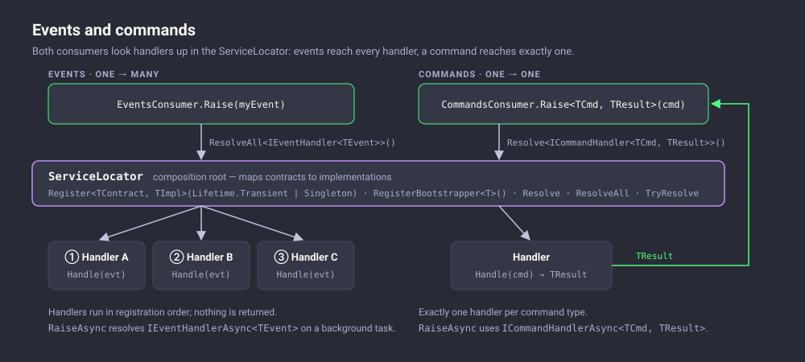

# Diagrams

Visual overviews of how Crispy Waffle is put together. Each diagram is an SVG file stored in [`docs/images/diagrams`](https://github.com/guibranco/CrispyWaffle/tree/main/docs/images/diagrams); click any diagram to open it at full size.

| Diagram | What it shows |
|:--------|:--------------|
| [Package architecture](#package-architecture) | The core package, its facades, and which integration packages plug into which extension point |
| [Logging pipeline](#logging-pipeline) | How a log call reaches every registered provider, and how exceptions are handled |
| [Caching](#caching) | The write path (all repositories) and the read path (priority order, promotion to memory) |
| [Events and commands](#events-and-commands) | One-to-many event dispatch versus one-to-one command dispatch through the service locator |
| [Background jobs](#background-jobs) | The `CrispyWaffle.BackgroundJobs` pipeline and the job lifecycle with retries |

## Package architecture

The core `CrispyWaffle` package exposes static facades such as `LogConsumer`, `CacheManager` and `ServiceLocator`. Integration packages implement the core extension points (`ILogProvider`, `ICacheRepository`, `ITelemetryClient`, `IExceptionHandler`). Packages that open connections to external services also reference `CrispyWaffle.Configuration`. `BackgroundJobs` and `HttpClient` are standalone and build on `Microsoft.Extensions.*`.

## Logging pipeline

`LogConsumer` resolves a category from the calling namespace, checks every `ILogFilter` for each provider, and writes to every registered `ILogProvider` that passes. Exceptions sent to `LogConsumer.Handle` go to the configured `IExceptionHandler`, which records telemetry and logs through the same providers.

See the [Logging guide](user-guide/logging.md) for usage.

## Caching

`CacheManager.SetAsync` writes to every repository in parallel. `CacheManager.GetAsync` tries repositories in priority order and returns the first hit; a value found outside memory is copied into `MemoryCacheRepository` in the background.

See the [Caching guide](user-guide/caching.md) for usage.

## Events and commands

`EventsConsumer` resolves every `IEventHandler<TEvent>` for an event and calls each one in registration order. `CommandsConsumer` resolves exactly one `ICommandHandler<TCommand, TResult>` and returns its result. Both look up handlers through the `ServiceLocator`.

See the [Events](user-guide/events.md), [Commands](user-guide/commands.md) and [Service Locator](user-guide/service-locator.md) guides for usage.

## Background jobs

`JobDispatcher` saves a pending job to an `IJobStore` (in memory or EF Core). `BackgroundWorker` loops fetch due jobs, find the handler registered under the job's name, and run it in a DI scope. Failed jobs are retried with exponential backoff until `MaxAttempt` is reached.

