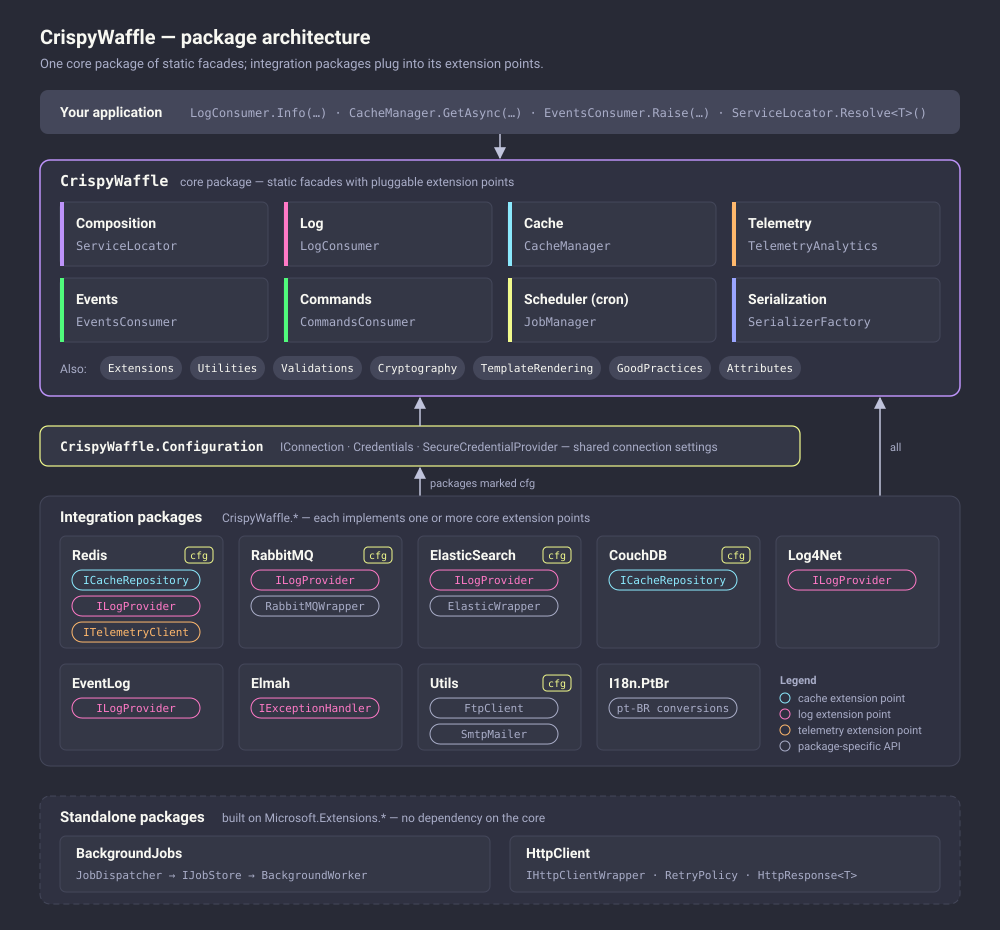

# Crispy Waffle

A toolkit for .NET applications: service location, logging, caching, events, commands, cron scheduling, serialization, template rendering and more, with integration packages for Redis, RabbitMQ, ElasticSearch, CouchDB, Log4Net, ELMAH and the Windows Event Log.


This project is proudly maintained by [@guibranco ](https://github.com/guibranco).

Source code available at: [GitHub ](https://github.com/guibranco/CrispyWaffle).

Currently opened issues: [](https://github.com/guibranco/crispywaffle/issues).

## Project status

| Build and tests | Release | Last commit | Coverage | Code Smells | Lines of Code |
|:---------------:|:-------:|:-----------:|:--------:|:-----------:|:-------------:|
| [](https://github.com/guibranco/CrispyWaffle/actions/workflows/build.yml) | [](https://github.com/guibranco/CrispyWaffle/actions/workflows/release.yml) | [](https://github.com/guibranco/CrispyWaffle) | [](https://sonarcloud.io/dashboard?id=guibranco_CrispyWaffle) | [](https://sonarcloud.io/dashboard?id=guibranco_CrispyWaffle) | [](https://sonarcloud.io/dashboard?id=guibranco_CrispyWaffle) |

## Quick look

```csharp
using CrispyWaffle.Cache;
using CrispyWaffle.Composition;
using CrispyWaffle.Log;
using CrispyWaffle.Log.Adapters;
using CrispyWaffle.Log.Providers;

ServiceLocator.Register<IConsoleLogAdapter, StandardConsoleLogAdapter>(Lifetime.Singleton);
LogConsumer.AddProvider<ConsoleLogProvider>();
CacheManager.AddRepository<MemoryCacheRepository>();

LogConsumer.Info("Hello from Crispy Waffle");

await CacheManager.SetAsync(42, "answer");
var answer = await CacheManager.GetAsync<int>("answer");
```

New here? Start with [Getting started](getting-started.md).

## Architecture

The core `CrispyWaffle` package exposes static facades with pluggable extension points. Integration packages implement those extension points, and two standalone packages build on `Microsoft.Extensions.*`.

[](images/diagrams/architecture.svg)

More diagrams (logging, caching, events and commands, background jobs) are on the [Diagrams](diagrams.md) page.

## Core modules

Everything below ships in the `CrispyWaffle` package.

| Module | What it does |
| :----- | :---------- |
| [Service Locator](core/service-locator.md) | Lightweight IoC container: register contracts, resolve instances, bootstrappers |
| [Logging](core/logging.md) | `LogConsumer` facade with filters, multiple providers and exception handlers |
| [Caching](core/caching.md) | `CacheManager` facade over prioritized cache repositories |
| [Events](core/events.md) | One-to-many event dispatch to `IEventHandler<TEvent>` implementations |
| [Commands](core/commands.md) | One-to-one command dispatch returning a result |
| [Scheduler](core/scheduler.md) | Cron-based job scheduling with `JobManager` |
| [Serialization](core/serialization.md) | JSON and XML serializer adapters, `SerializerFactory` |
| [Telemetry](core/telemetry.md) | `TelemetryAnalytics` facade for counters, events and exceptions |
| [Template rendering](core/template-rendering.md) | Mustache-style text template engine |
| [Cryptography](core/cryptography.md) | AES string encryption and MD5/SHA hashing (legacy compatibility) |
| [Extension methods](core/extensions.md) | Conversion, string, enum, exception, math, type and XML helpers |
| [Utilities](core/utilities.md) | Query string builder, resettable lazy values, dynamic serialization, phone numbers |
| [Validations](core/validations.md) | CPF, CNPJ and e-mail validation, shared regular expressions |
| [Attributes](core/attributes.md) | Metadata attributes used across the library |
| [Good practices](core/good-practices.md) | Small building blocks for safer code |
| [Infrastructure](core/infrastructure.md) | Environment information and library constants |

## Integration packages

| Package | What it adds |
| :------ | :---------- |
| [CrispyWaffle.Configuration](packages/configuration.md) | Connection and credential abstractions shared by the integration packages |
| [CrispyWaffle.Redis](packages/redis.md) | Redis cache repository, Pub/Sub log provider and telemetry client |
| [CrispyWaffle.RabbitMQ](packages/rabbitmq.md) | RabbitMQ messaging wrapper and log provider |
| [CrispyWaffle.ElasticSearch](packages/elasticsearch.md) | ElasticSearch client wrapper and log provider |
| [CrispyWaffle.CouchDB](packages/couchdb.md) | CouchDB cache repository (not yet on NuGet) |
| [CrispyWaffle.Log4Net](packages/log4net.md) | Log provider that forwards to log4net |
| [CrispyWaffle.EventLog](packages/eventlog.md) | Windows Event Log provider |
| [CrispyWaffle.Elmah](packages/elmah.md) | Exception handler that forwards to ELMAH |
| [CrispyWaffle.Utils](packages/utils.md) | FTP client and SMTP mailer |
| [CrispyWaffle.I18n.PtBr](packages/i18n-ptbr.md) | Brazilian Portuguese conversions |
| [CrispyWaffle.HttpClient](packages/http-client.md) | Standalone typed HTTP client wrapper with retries (not yet on NuGet) |
| [CrispyWaffle.BackgroundJobs](packages/background-jobs.md) | Standalone hosted background job processing (not yet on NuGet) |

## Examples

Most features are covered by tests, and the [test projects](https://github.com/guibranco/CrispyWaffle/tree/main/Tests) are a good source of working examples.
