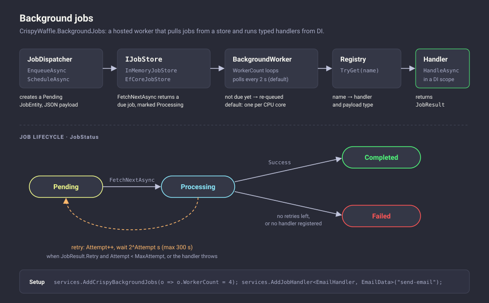

# CrispyWaffle.BackgroundJobs

`CrispyWaffle.BackgroundJobs` runs fire-and-forget and delayed jobs inside an ASP.NET Core application. You register typed handlers under a name, enqueue a job with that name and a payload, and a hosted worker picks it up, runs the handler in its own DI scope, and retries it with exponential backoff when it fails. Jobs are kept in an in-memory store by default, or in a database through Entity Framework Core.

The package is standalone: it does not reference the core `CrispyWaffle` package. It is built on `Microsoft.Extensions.Hosting` (`BackgroundService`) and `Microsoft.Extensions.DependencyInjection`. It is a different thing from the core package's [cron scheduler](../core/scheduler.md): that one runs in-process actions on cron expressions through `JobManager`, while this package queues persisted, retryable jobs that carry a payload. The `CronJobService` base class in this package does not parse cron expressions (see [Recurring work](#recurring-work)).

| | |
|---|---|
| **Package** | `CrispyWaffle.BackgroundJobs` |
| **Namespace** | `CrispyWaffle.BackgroundJobs.Abstractions`, `CrispyWaffle.BackgroundJobs.Core`, `CrispyWaffle.BackgroundJobs.Extensions`, `CrispyWaffle.BackgroundJobs.Persistence`, `CrispyWaffle.BackgroundJobs.Scheduling`, `CrispyWaffle.BackgroundJobs.Monitoring`, `CrispyWaffle.BackgroundJobs.Exceptions` |
| **Install** | Not yet published to NuGet (it is not in the release workflow's package list). Reference the project: `dotnet add reference Src/CrispyWaffle.BackgroundJobs/CrispyWaffle.BackgroundJobs.csproj` |
| **Target framework** | `net10.0` only |
| **Depends on** | No CrispyWaffle packages. `Microsoft.Extensions.Hosting.Abstractions`, `Microsoft.AspNetCore.Hosting.Abstractions` (for `IStartupFilter` and the middleware), `Microsoft.EntityFrameworkCore` and `Microsoft.EntityFrameworkCore.Relational` |

## How it works

[](../images/diagrams/background-jobs.svg)

### Registration

`AddCrispyBackgroundJobs` registers, all as singletons unless noted:

| Service | Implementation |
|---|---|
| `JobOptions` | The instance built from your `configureOptions` callback |
| `IJobHandlerRegistry` | `JobHandlerRegistry` |
| `JobDispatcher` | `JobDispatcher` |
| `JobMetrics` | `JobMetrics` |
| `IJobScheduler` | `DelayedJobScheduler` |
| `IJobStore` | `InMemoryJobStore` (default), or `EfCoreJobStore` as **scoped** when `useEfCoreStore: true` |
| `BackgroundJobQueue` | Only in the default (in-memory) mode |
| Hosted service | `BackgroundWorker` |

`IJobStore` and `BackgroundJobQueue` are added with `TryAdd`, so a store you register before the call wins.

`AddJobHandler<THandler, TData>(name)` registers `THandler` as scoped and adds an `IStartupFilter` that calls `IJobHandlerRegistry.Register<THandler, TData>(name)` when the ASP.NET Core request pipeline is built. This means `AddJobHandler` only populates the registry in an ASP.NET Core host. In a generic host (worker service) the filter never runs; register the handler type in DI yourself and call `Register` on the registry after building the host (see [Use a generic host](#use-a-generic-host)).

### Enqueueing

`JobDispatcher.EnqueueAsync` (or `IJobScheduler.EnqueueAsync`) creates a `JobEntity` with `Status = Pending`, the handler name, the priority, `MaxAttempt`, and the payload serialized with `System.Text.Json` default options, then saves it with `IJobStore.SaveAsync`. `ScheduleAsync` does the same with `ScheduledAt = UtcNow + delay`; the job stays in the store until it is due.

Only when no `IJobStore` is registered does the dispatcher fall back to the `BackgroundJobQueue`: `EnqueueAsync` pushes the job onto the queue, and `ScheduleAsync` waits for the delay in a background `Task` and then pushes it. With `AddCrispyBackgroundJobs` a store is always registered, so this path is not used.

### Worker loop

`BackgroundWorker` starts `JobOptions.WorkerCount` loops (default: one per processor). Each loop:

1. Calls `IJobStore.FetchNextAsync`, which returns the oldest due `Pending` job with the highest priority (`High` before `Normal` before `Low`, then by `CreatedAt`) and marks it `Processing`. If nothing is due, the loop sleeps for `JobOptions.PollingInterval` (default 2 seconds).
2. If the job's `ScheduledAt` is still in the future, puts it back (`MarkRetryAsync` with the same time) and moves on.
3. Creates a DI scope, looks up the handler type and payload type in `IJobHandlerRegistry`, deserializes the payload into the payload type, resolves the handler from the scope, and calls its `HandleAsync`.
4. Records the outcome in the store (see below).

An unexpected error in the loop itself is logged and the loop waits 1 second before continuing.

The handler is invoked by reflection: the worker looks up a **public** method named `HandleAsync` on the concrete handler type. Implement `IBackgroundJobHandler<TData>.HandleAsync` as a normal public method, not as an explicit interface implementation, and do not add other `HandleAsync` overloads; otherwise the call throws and the job is retried as described below.

### Lifecycle and retries

| Outcome | What happens |
|---|---|
| Handler returns `JobResult.Ok()` | `MarkCompletedAsync`: status `Completed`. |
| Handler returns `JobResult.Fail(message, retry: true)` and `Attempt + 1 < MaxAttempt` | `Attempt` is incremented and `MarkRetryAsync` sets status `Pending` with `ScheduledAt = UtcNow + backoff`. |
| Handler returns `Fail` with `retry: false`, or attempts are used up | `MarkFailedAsync`: status `Failed`, `LastError = message` (or `"Job failed"` when the message is `null`). |
| No handler registered under the job's name | `MarkFailedAsync` with `"No handler registered for '<name>'"`. Not retried. |
| Handler type cannot be resolved from DI | `MarkFailedAsync` with `"Handler type <type> not resolved from DI"`. Not retried. |
| Handler throws, or the payload cannot be deserialized | Logged, `Attempt` incremented, rescheduled with backoff. `MaxAttempt` is **not** checked on this path, so a job that always throws is retried indefinitely (every 300 seconds once the cap is reached). |

The backoff is `min(2^min(Attempt, 10), 300)` seconds, where `Attempt` is the already incremented count: 2, 4, 8, 16, 32, 64, 128, 256, then 300 seconds. The cap is hard-coded; `JobOptions.MaxBackoffSeconds` is not read. `JobEntity.RetryDelaySeconds` is also not read.

`MaxAttempt` counts total executions. With the default of 3, a handler that keeps returning `Fail(..., retry: true)` runs three times and is then marked `Failed`.

On shutdown, a job interrupted by the stopping token is normally caught by the "handler throws" path and rescheduled with backoff. The `JobStatus.Dead` value is never assigned by the library.

### Job stores

**In-memory (default).** `InMemoryJobStore` keeps jobs in a `ConcurrentDictionary`. Jobs are lost when the process stops, and completed and failed jobs are never removed. `FetchNextAsync` selects and marks a job in two separate steps without a lock, so with more than one worker the same job can occasionally be picked by two loops. Set `WorkerCount = 1` if handlers must not run twice.

**EF Core.** Pass `useEfCoreStore: true` and register `JobDbContext` yourself with your database provider, for example `services.AddDbContext<JobDbContext>(o => o.UseSqlServer(connectionString))`. You must also create the `Jobs` table, for example with `db.Database.EnsureCreated()` or with migrations generated against `JobDbContext` (migrations need a `MigrationsAssembly` in your project, since the context lives in this package).

The EF Core mode has wiring problems you need to work around:

- `JobDispatcher` takes a `BackgroundJobQueue` constructor parameter, but the queue is only registered in in-memory mode. Without `services.AddSingleton<BackgroundJobQueue>()`, resolving `JobDispatcher` or `IJobScheduler` fails.
- `EfCoreJobStore` is scoped, but the singleton `BackgroundWorker` and `JobDispatcher` resolve it from the root provider. With scope validation enabled (the default in the `Development` environment) the host fails to start with a "Cannot consume scoped service" error. With validation disabled, a single `JobDbContext` instance is shared by every worker loop and every caller of the dispatcher. `DbContext` is not thread-safe, so keep `WorkerCount = 1` and avoid enqueueing while the worker is running, or register your own `IJobStore` that creates a context per call.
- No concurrency token is configured on `JobEntity`, so `FetchNextAsync` does not prevent two processes from claiming the same job.

Treat the EF Core store as experimental until these are fixed.

### Monitoring

`JobMetrics` is a singleton dictionary of named counters. The library registers it but does not increment any counter itself, so you record the values you care about, for example from your handlers. `MonitoringMiddleware` serves `JobMetrics.Snapshot()` as a JSON object (`{"counter": value}`) for any request whose path starts with the segment `/jobs/metrics`, and passes every other request on. There is no `UseXxx` extension; add it with `app.UseMiddleware<MonitoringMiddleware>()`. The endpoint has no authentication of its own.

### Recurring work

`CronJobService` is an abstract `BackgroundService` that calls `ExecuteOnce` in a loop with a fixed one-minute delay after each run. Despite the file name (`CronJobScheduler.cs`), it does not accept or parse a cron expression, and it is not registered by `AddCrispyBackgroundJobs`. Register a subclass with `AddHostedService`. For real cron expressions, use the core [scheduler](../core/scheduler.md), or enqueue jobs from your subclass.

## Getting started

```csharp
using CrispyWaffle.BackgroundJobs.Abstractions;
using CrispyWaffle.BackgroundJobs.Core;
using CrispyWaffle.BackgroundJobs.Extensions;

var builder = WebApplication.CreateBuilder(args);

builder.Services.AddCrispyBackgroundJobs(o => o.WorkerCount = 2);
builder.Services.AddJobHandler<SendEmailHandler, SendEmailData>("send-email");

var app = builder.Build();

app.MapPost(
    "/signup",
    async (string email, IJobScheduler jobs) =>
    {
        await jobs.EnqueueAsync("send-email", new SendEmailData(email, "Welcome!"));
        return Results.Accepted();
    }
);

app.Run();

public sealed record SendEmailData(string To, string Subject);

public sealed class SendEmailHandler(ILogger<SendEmailHandler> logger)
    : IBackgroundJobHandler<SendEmailData>
{
    public async Task<JobResult> HandleAsync(SendEmailData data, CancellationToken cancellationToken)
    {
        try
        {
            logger.LogInformation("Sending '{Subject}' to {To}", data.Subject, data.To);
            await Task.Delay(100, cancellationToken); // send the email here
            return JobResult.Ok();
        }
        catch (HttpRequestException ex)
        {
            return JobResult.Fail(ex.Message, retry: true);
        }
    }
}
```

## Reference

### `ServiceCollectionExtensions`

`public static class ServiceCollectionExtensions` — registration entry points (namespace `CrispyWaffle.BackgroundJobs.Extensions`).

| Member | Description |
|---|---|
| `AddCrispyBackgroundJobs(this IServiceCollection services, Action<JobOptions>? configureOptions = null, bool useEfCoreStore = false)` | Registers the services listed in [Registration](#registration) and the `BackgroundWorker` hosted service. With `useEfCoreStore: true`, registers `EfCoreJobStore` as scoped `IJobStore`; you must register `JobDbContext` (and, see [Job stores](#job-stores), `BackgroundJobQueue`). Returns `services`. |
| `AddJobHandler<THandler, TData>(this IServiceCollection services, string handlerName)` | Constraint: `THandler : class, IBackgroundJobHandler<TData>`. Registers `THandler` as scoped and an `IStartupFilter` that adds `handlerName` to the registry when the ASP.NET Core pipeline is built. Has no effect on the registry in a non-web host. Returns `services`. |

### `IJobScheduler`

`public interface IJobScheduler` — the injectable API for adding jobs (namespace `CrispyWaffle.BackgroundJobs.Abstractions`).

| Member | Description |
|---|---|
| `EnqueueAsync(string handlerName, object payload, int maxAttempts = 3, JobPriority priority = JobPriority.Normal)` | Adds a job that is due immediately. Returns `Task` (the job id is not exposed; use `JobDispatcher` to get it). |
| `ScheduleAsync(string handlerName, object payload, TimeSpan delay, int maxAttempts = 3, JobPriority priority = JobPriority.Normal)` | Adds a job that becomes due after `delay`. Returns `Task`. |

Because `maxAttempts` defaults to `3` here and is always passed on, `JobOptions.DefaultMaxAttempt` has no effect for jobs added through `IJobScheduler`.

### `DelayedJobScheduler`

`public class DelayedJobScheduler : IJobScheduler` — default `IJobScheduler`; forwards both methods to `JobDispatcher` (namespace `CrispyWaffle.BackgroundJobs.Scheduling`).

| Member | Description |
|---|---|
| `DelayedJobScheduler(IServiceProvider provider)` | Constructor. `JobDispatcher` is resolved from `provider` on every call. |
| `EnqueueAsync(...)` / `ScheduleAsync(...)` | See `IJobScheduler`. |

### `JobDispatcher`

`public class JobDispatcher` — creates `JobEntity` records and hands them to the store or the queue (namespace `CrispyWaffle.BackgroundJobs.Core`).

| Member | Description |
|---|---|
| `JobDispatcher(IServiceProvider provider, BackgroundJobQueue? queue, IJobStore? store, JobOptions options)` | Constructor. Despite the nullable annotations, the DI container requires both `BackgroundJobQueue` and `IJobStore` to be registered. |
| `EnqueueAsync(string handlerName, object payload, int? maxAttempts = null, JobPriority priority = JobPriority.Normal)` | Creates a pending job (`MaxAttempt = maxAttempts ?? options.DefaultMaxAttempt`) and saves it to the store, or enqueues it when there is no store. Returns `Task<Guid>`, the job id. |
| `ScheduleAsync(string handlerName, object payload, TimeSpan delay, int? maxAttempts = null, JobPriority priority = JobPriority.Normal)` | Same, with `ScheduledAt = UtcNow + delay`. Without a store, waits `delay` in a background task before enqueueing (lost if the process stops). Returns `Task`. |

### `IBackgroundJobHandler<TData>`

`public interface IBackgroundJobHandler<TData>` — implement this to handle one kind of job (namespace `CrispyWaffle.BackgroundJobs.Abstractions`). Handlers are resolved from a new DI scope per job, so they can depend on scoped services.

| Member | Description |
|---|---|
| `HandleAsync(TData data, CancellationToken cancellationToken)` | Runs the job. `data` is the payload deserialized with `System.Text.Json` default options (`null`/`default` when the payload is empty). The token is the host's stopping token. Return `JobResult.Ok()` or `JobResult.Fail(...)`. Must be a public method on the handler class (see [Worker loop](#worker-loop)). |

### `IBackgroundJob`

`public interface IBackgroundJob` — a payload-less job abstraction (namespace `CrispyWaffle.BackgroundJobs.Abstractions`). Nothing in the package executes it; the worker only runs `IBackgroundJobHandler<TData>` handlers.

| Member | Description |
|---|---|
| `ExecuteAsync(CancellationToken cancellationToken)` | Returns `Task<JobResult>`. |

### `JobResult`

`public sealed record JobResult(bool Success, bool Retry = false, string? ErrorMessage = null)` — the outcome returned by a handler (namespace `CrispyWaffle.BackgroundJobs.Core`).

| Member | Description |
|---|---|
| `Success` | `true` when the job succeeded. |
| `Retry` | When `Success` is `false`, whether the worker should retry (subject to `MaxAttempt`). |
| `ErrorMessage` | Stored in `JobEntity.LastError` when the job ends as `Failed`. |
| `Ok()` | Static. Returns a successful result. |
| `Fail(string message, bool retry = false)` | Static. Returns a failed result. Note that `retry` defaults to `false`, so a plain `Fail("...")` is not retried. |

### `IJobHandlerRegistry`

`public interface IJobHandlerRegistry` — maps handler names to handler and payload types (namespace `CrispyWaffle.BackgroundJobs.Core`).

| Member | Description |
|---|---|
| `Register<THandler, TData>(string handlerName)` | Constraint: `THandler : class, IBackgroundJobHandler<TData>`. Adds or replaces the mapping for `handlerName`. |
| `TryGet(string handlerName, out Type? handlerType, out Type? dataType)` | Returns `true` and the two types when `handlerName` is registered. |

### `JobHandlerRegistry`

`public class JobHandlerRegistry : IJobHandlerRegistry` — thread-safe default registry backed by a `ConcurrentDictionary`.

| Member | Description |
|---|---|
| `Register<THandler, TData>(string handlerName)` | Throws `ArgumentException` when `handlerName` is null, empty or whitespace. Names are case-sensitive. |
| `TryGet(string handlerName, out Type? handlerType, out Type? dataType)` | Returns `false` for a `null` or unknown name. |

### `IJobStore`

`public interface IJobStore` — persistence for jobs (namespace `CrispyWaffle.BackgroundJobs.Abstractions`). Implement it to use another storage; register your implementation before calling `AddCrispyBackgroundJobs`.

| Member | Description |
|---|---|
| `SaveAsync(JobEntity job, CancellationToken cancellationToken = default)` | Stores a new job. |
| `FetchNextAsync(CancellationToken cancellationToken = default)` | Returns the next due `Pending` job (`ScheduledAt` null or not after now) and marks it `Processing`, or `null`. Implementations should claim the job atomically. |
| `MarkCompletedAsync(Guid jobId, CancellationToken cancellationToken = default)` | Sets status `Completed`. |
| `MarkFailedAsync(Guid jobId, string error, CancellationToken cancellationToken = default)` | Sets status `Failed` and `LastError`. |
| `MarkRetryAsync(Guid jobId, DateTimeOffset? nextAttemptAt, int attemptCount, CancellationToken cancellationToken = default)` | Sets status `Pending`, `ScheduledAt = nextAttemptAt` and `Attempt = attemptCount`. |

### `InMemoryJobStore`

`public class InMemoryJobStore : IJobStore` — default store, process-local (namespace `CrispyWaffle.BackgroundJobs.Persistence`). Implements every `IJobStore` member; all methods complete synchronously and ignore the token. Unknown ids are ignored. See [Job stores](#job-stores) for its limits.

### `EfCoreJobStore`

`public class EfCoreJobStore : IJobStore` — store backed by `JobDbContext` (namespace `CrispyWaffle.BackgroundJobs.Persistence`).

| Member | Description |
|---|---|
| `EfCoreJobStore(JobDbContext db)` | Constructor. |
| `SaveAsync(...)` | Sets `UpdatedAt`, adds the job and calls `SaveChangesAsync`. |
| `FetchNextAsync(...)` | Queries the first due pending job id ordered by priority then `CreatedAt`, loads it, sets `Processing` and saves. Returns `null` if nothing is due or if `SaveChangesAsync` throws `DbUpdateConcurrencyException`. |
| `MarkCompletedAsync(...)` / `MarkFailedAsync(...)` / `MarkRetryAsync(...)` | Load the job, update it as described in `IJobStore`, and save. Unknown ids are ignored. |

### `JobDbContext`

`public class JobDbContext : DbContext` — EF Core context for the `EfCoreJobStore` (namespace `CrispyWaffle.BackgroundJobs.Persistence`).

| Member | Description |
|---|---|
| `JobDbContext(DbContextOptions<JobDbContext> options)` | Constructor, used by `AddDbContext<JobDbContext>`. |
| `Jobs` | `DbSet<JobEntity>`. |
| `OnModelCreating(ModelBuilder modelBuilder)` | Protected. Key `Id`; `HandlerName` required, max length 256; `Payload` optional; `Priority` and `Status` stored as `int`; `CreatedAt` and `UpdatedAt` required; database defaults `MaxAttempt = 3` and `Attempt = 0`. |

### `BackgroundWorker`

`public class BackgroundWorker : BackgroundService` — the hosted service that runs jobs (namespace `CrispyWaffle.BackgroundJobs.Core`). Registered by `AddCrispyBackgroundJobs`; you do not use it directly. See [Worker loop](#worker-loop) and [Lifecycle and retries](#lifecycle-and-retries).

| Member | Description |
|---|---|
| `BackgroundWorker(IServiceProvider provider, JobOptions options, ILogger<BackgroundWorker> logger)` | Constructor. Resolves `BackgroundJobQueue` and `IJobStore` (both optional) and `IJobHandlerRegistry` (required) from `provider`. Uses the store when one is registered, otherwise the queue. |
| `ExecuteAsync(CancellationToken stoppingToken)` | Protected override. Starts `WorkerCount` loops and completes when all of them stop. |

### `BackgroundJobQueue`

`public class BackgroundJobQueue` — in-memory priority queue used only when no `IJobStore` is registered (namespace `CrispyWaffle.BackgroundJobs.Core`).

| Member | Description |
|---|---|
| `Enqueue(JobEntity job)` | Adds the job with its `Priority` (lower value first) and signals a waiting consumer. |
| `DequeueAsync(CancellationToken cancellationToken)` | Waits for a signal and returns the highest-priority job. Returns `null` when cancelled. |

When the worker uses this queue, a job that is not yet due is dequeued and enqueued again in a tight loop until it is due.

### `JobOptions`

`public class JobOptions` — worker settings, configured through `AddCrispyBackgroundJobs` (namespace `CrispyWaffle.BackgroundJobs.Core`). Registered as a plain singleton, not through `IOptions<T>`.

| Member | Description |
|---|---|
| `WorkerCount` | `int`. Number of concurrent worker loops. Default `Environment.ProcessorCount`. |
| `DefaultMaxAttempt` | `int`. `MaxAttempt` for jobs added through `JobDispatcher` without `maxAttempts`. Default `3`. |
| `PollingInterval` | `TimeSpan`. Sleep between store polls when no job is due. Default 2 seconds. |
| `MaxBackoffSeconds` | `int`. Default `300`. Not used; the worker's 300-second cap is hard-coded. |

### `JobEntity`

`public class JobEntity` — a stored job (namespace `CrispyWaffle.BackgroundJobs.Abstractions`).

| Member | Description |
|---|---|
| `Id` | `Guid`. Default `Guid.NewGuid()`. |
| `HandlerName` | `string`. Name registered in `IJobHandlerRegistry`. Default empty. |
| `Payload` | `string`. JSON payload. Default empty. |
| `Priority` | `JobPriority`. Default `Normal`. |
| `Status` | `JobStatus`. Default `Pending`. |
| `ScheduledAt` | `DateTimeOffset?`. When the job becomes due; `null` means immediately. |
| `Attempt` | `int`. Number of failed executions so far. Default `0`. |
| `MaxAttempt` | `int`. Maximum executions for `JobResult.Fail(..., retry: true)` outcomes. Default `3`. |
| `LastError` | `string?`. Error recorded when the job is marked `Failed`. |
| `CreatedAt` | `DateTimeOffset`. Default `UtcNow` at construction. |
| `UpdatedAt` | `DateTimeOffset`. Updated by the stores on every change. |
| `RetryDelaySeconds` | `int`. Default `0`. Not used by the worker. |

### `JobPriority`

`public enum JobPriority` — lower values run first.

| Value | Description |
|---|---|
| `High` (0) | Picked before `Normal` and `Low`. |
| `Normal` (1) | Default. |
| `Low` (2) | Picked last. |

### `JobStatus`

`public enum JobStatus` — job lifecycle state.

| Value | Description |
|---|---|
| `Pending` (0) | Waiting to run, or waiting for a retry. |
| `Processing` (1) | Claimed by a worker. |
| `Completed` (2) | Handler returned success. |
| `Failed` (3) | Handler failed with no retries left, did not ask for a retry, or could not be found. |
| `Dead` (4) | Not used by the library. |

### `JobMetrics`

`public class JobMetrics` — thread-safe named counters, registered as a singleton (namespace `CrispyWaffle.BackgroundJobs.Monitoring`). Nothing in the package increments them.

| Member | Description |
|---|---|
| `Increment(string key)` | Adds 1 to `key`, creating it at 1. |
| `Get(string key)` | Returns the value of `key`, or `0`. |
| `Snapshot()` | Returns a copy of all counters as `IDictionary<string, long>`. |

### `MonitoringMiddleware`

`public class MonitoringMiddleware` — ASP.NET Core middleware that exposes `JobMetrics` (namespace `CrispyWaffle.BackgroundJobs.Monitoring`).

| Member | Description |
|---|---|
| `MonitoringMiddleware(RequestDelegate next, JobMetrics metrics)` | Constructor, called by `UseMiddleware<MonitoringMiddleware>()`. |
| `InvokeAsync(HttpContext context)` | For paths starting with `/jobs/metrics`, writes the snapshot as `application/json` and ends the request. Otherwise calls `next`. |

### `CronJobService`

`public abstract class CronJobService : BackgroundService` — base class for work that repeats every minute (namespace `CrispyWaffle.BackgroundJobs.Scheduling`). See [Recurring work](#recurring-work).

| Member | Description |
|---|---|
| `CronJobService(ILogger logger)` | Protected constructor. |
| `ExecuteOnce(CancellationToken stoppingToken)` | Protected abstract. Your work. Exceptions are logged and the loop continues. |
| `ExecuteAsync(CancellationToken stoppingToken)` | Protected override. Calls `ExecuteOnce`, then waits one minute, until the host stops. |

### `JobFailedException`

`public class JobFailedException : Exception` — namespace `CrispyWaffle.BackgroundJobs.Exceptions`. Has one constructor, `JobFailedException(string message)`. The package never throws it; if a handler throws it, it is treated like any other exception (logged and retried).

## Examples

### Schedule a delayed, high-priority job

`JobDispatcher` returns the job id; `IJobScheduler` does not.

```csharp
using CrispyWaffle.BackgroundJobs.Abstractions;
using CrispyWaffle.BackgroundJobs.Core;

public sealed class ReminderService(JobDispatcher dispatcher)
{
    public Task<Guid> RemindNowAsync(string email) =>
        dispatcher.EnqueueAsync("send-email", new SendEmailData(email, "Reminder"));

    public Task RemindLaterAsync(string email) =>
        dispatcher.ScheduleAsync(
            "send-email",
            new SendEmailData(email, "Your trial ends tomorrow"),
            TimeSpan.FromHours(1),
            maxAttempts: 5,
            priority: JobPriority.High
        );
}
```

### Expose metrics

Increment counters from your handlers and map the middleware.

```csharp
using CrispyWaffle.BackgroundJobs.Abstractions;
using CrispyWaffle.BackgroundJobs.Core;
using CrispyWaffle.BackgroundJobs.Extensions;
using CrispyWaffle.BackgroundJobs.Monitoring;

var builder = WebApplication.CreateBuilder(args);
builder.Services.AddCrispyBackgroundJobs();
builder.Services.AddJobHandler<ResizeImageHandler, ResizeImageData>("resize-image");

var app = builder.Build();
app.UseMiddleware<MonitoringMiddleware>(); // GET /jobs/metrics -> {"resize-image.ok":12}
app.Run();

public sealed record ResizeImageData(string Path, int Width);

public sealed class ResizeImageHandler(JobMetrics metrics) : IBackgroundJobHandler<ResizeImageData>
{
    public Task<JobResult> HandleAsync(ResizeImageData data, CancellationToken cancellationToken)
    {
        // resize data.Path to data.Width here
        metrics.Increment("resize-image.ok");
        return Task.FromResult(JobResult.Ok());
    }
}
```

### Use the EF Core store

Register the context, the queue that `JobDispatcher` needs, and create the table at startup. Keep one worker because the store's `DbContext` is shared (see [Job stores](#job-stores)), and disable scope validation, which otherwise rejects the scoped store inside singletons.

```csharp
using CrispyWaffle.BackgroundJobs.Core;
using CrispyWaffle.BackgroundJobs.Extensions;
using CrispyWaffle.BackgroundJobs.Persistence;
using Microsoft.EntityFrameworkCore;

var builder = WebApplication.CreateBuilder(args);
builder.Host.UseDefaultServiceProvider(o =>
{
    o.ValidateScopes = false;
    o.ValidateOnBuild = false;
});

builder.Services.AddDbContext<JobDbContext>(o =>
    o.UseSqlServer(builder.Configuration.GetConnectionString("Jobs"))
);
builder.Services.AddSingleton<BackgroundJobQueue>();
builder.Services.AddCrispyBackgroundJobs(o => o.WorkerCount = 1, useEfCoreStore: true);
builder.Services.AddJobHandler<SendEmailHandler, SendEmailData>("send-email");

var app = builder.Build();
using (var scope = app.Services.CreateScope())
{
    scope.ServiceProvider.GetRequiredService<JobDbContext>().Database.EnsureCreated();
}
app.Run();
```

`UseSqlServer` comes from the `Microsoft.EntityFrameworkCore.SqlServer` package; use the provider for your database.

### Use a generic host

`AddJobHandler` relies on an ASP.NET Core startup filter. In a worker service, register the handler in DI and in the registry yourself before the host starts.

```csharp
using CrispyWaffle.BackgroundJobs.Core;
using CrispyWaffle.BackgroundJobs.Extensions;

var builder = Host.CreateApplicationBuilder(args);
builder.Services.AddCrispyBackgroundJobs();
builder.Services.AddScoped<SendEmailHandler>();

var host = builder.Build();
host.Services.GetRequiredService<IJobHandlerRegistry>()
    .Register<SendEmailHandler, SendEmailData>("send-email");

host.Run();
```

### Run work every minute

```csharp
using CrispyWaffle.BackgroundJobs.Abstractions;
using CrispyWaffle.BackgroundJobs.Scheduling;

public sealed class CleanupService(ILogger<CleanupService> logger, IJobScheduler jobs)
    : CronJobService(logger)
{
    protected override Task ExecuteOnce(CancellationToken stoppingToken) =>
        jobs.EnqueueAsync("cleanup", new { OlderThanDays = 30 });
}

// builder.Services.AddHostedService<CleanupService>();
```

The anonymous payload is serialized as `{"OlderThanDays":30}`, so the `cleanup` handler's payload type needs a matching `OlderThanDays` property.

## See also

- [Diagrams](../diagrams.md)
- [Scheduler](../core/scheduler.md) for cron-based scheduling in the core package
- [HTTP client](http-client.md), the other standalone `Microsoft.Extensions` based package
