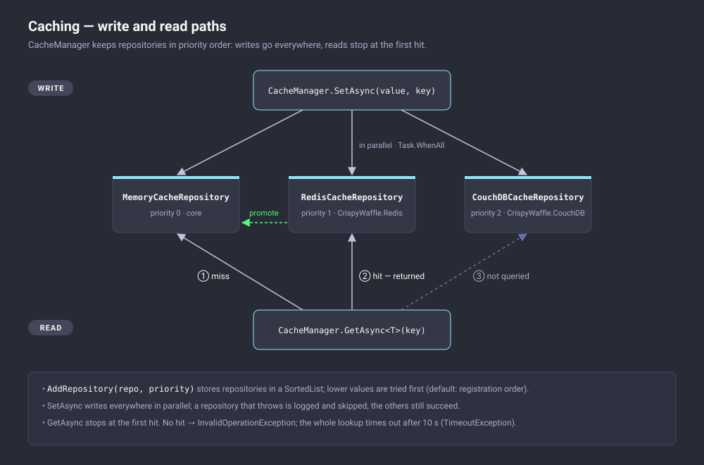
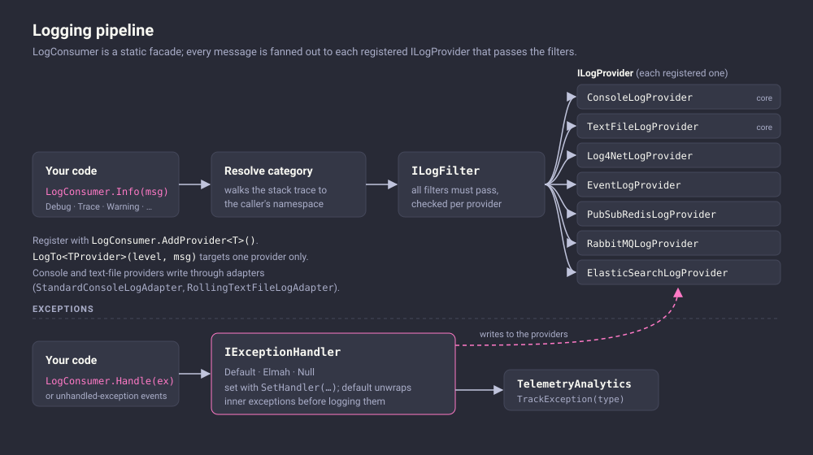

# CrispyWaffle.Redis

CrispyWaffle.Redis connects CrispyWaffle to [Redis](https://redis.io). It has four parts:

- A cache repository for `CacheManager`.
- A log provider that publishes log messages to Redis Pub/Sub channels.
- A telemetry client that stores hits, events and metrics in Redis.
- Helpers for master/replica setups and quick counter operations.

Use it when several processes or machines need a shared cache, when you want log messages streamed to listeners in real time, or when you want lightweight counters stored in Redis.

| | |
|---|---|
| **Package** | `CrispyWaffle.Redis` |
| **Namespace** | `CrispyWaffle.Redis.Cache`, `CrispyWaffle.Redis.Log`, `CrispyWaffle.Redis.Log.PropagationStrategy`, `CrispyWaffle.Redis.Telemetry`, `CrispyWaffle.Redis.Utils`, `CrispyWaffle.Redis.Utils.Communications` |
| **Install** | `dotnet add package CrispyWaffle.Redis` |
| **Depends on** | `CrispyWaffle`, `CrispyWaffle.Configuration`, `StackExchange.Redis`, `StackExchange.Redis.Extensions.Core` |

## How it works

### The connector

Everything in this package goes through a `RedisConnector`. The connector builds a StackExchange.Redis.Extensions `RedisConfiguration` with these settings:

- `AbortOnConnectFail = false` and `AllowAdmin = true`.
- A server enumeration strategy of `All` servers, `Any` role, and `Throw` on unreachable servers.
- A host list parsed from a comma-separated string of `host[:port]` entries. The port defaults to `6379` when it's missing.

From that configuration, the connector creates a `RedisConnectionPoolManager` and a `RedisClient`.

Every connector needs an `ISerializer` from `StackExchange.Redis.Extensions.Core`. That serializer converts cached values to and from bytes. The package doesn't include an implementation, so either reference a serializer package such as `StackExchange.Redis.Extensions.System.Text.Json` or write your own (see [Getting started](#getting-started)).

You can create a connector in several ways:

- From an `IConnection` (`Host`, `Port` and `Credentials.Password` are used; the username is ignored).
- From a host and a port.
- From a raw host list.
- From a `MasterSlaveConfiguration`, which combines two connections.
- From an existing `IRedisClient` and `IRedisConnectionPoolManager`.

Register the connector as a singleton, because it owns the connection pool.

`QueuePrefix` defaults to `"crispy-waffle"`. The Pub/Sub log provider uses it to name channels. The overloads that take a `queuePrefix` throw `ArgumentNullException` when it's `null`.

### Cache repository

[](../images/diagrams/caching.svg)

`RedisCacheRepository` implements `ICacheRepository`, so you can add it to `CacheManager` alongside other repositories.

- The `ICacheRepository` methods always use database 0 (`IRedisClient.Db0`) and the connector's serializer.
- Sub-key entries are stored as Redis hashes. `SetAsync(value, key, subKey)` reads the whole hash, sets one field, and writes the hash back with `FireAndForget`.
- `SetToDatabase`, `GetFromDatabase`, `TryGetFromDatabase` and `RemoveFromDatabase` work with any database number and call the connector serializer directly.

Errors depend on `ShouldPropagateExceptions`, which defaults to `false`:

- When it's `false`, failures are logged instead of thrown. Exceptions whose message contains "timeout" go to `LogConsumer.Trace`; all others go to `LogConsumer.Handle`.
- `OperationCanceledException` and argument-validation exceptions are always rethrown.
- `GetAsync` throws `InvalidOperationException` when the key is missing. It also throws `InvalidOperationException` after logging a suppressed error, so a missing key and a failed call look the same to the caller.
- The `TryGetAsync` overloads return `(false, default)` in both of those cases instead.

`Dispose()` disposes the underlying `RedisConnector`. If several components share one connector, don't dispose the repository until all of them are done.

### Pub/Sub log provider

[](../images/diagrams/logging-pipeline.svg)

`PubSubRedisLogProvider` is an `ILogProvider`. Each logging call that passes the level check builds a `LogMessage`, serializes it to JSON, and adds it to an in-memory `ConcurrentQueue<string>`. The `LogMessage` carries:

- The date, host name and process ID.
- The local and remote IP addresses.
- The operation, user agent, thread ID and thread name.
- A new GUID as the message `Id`.

The constructor starts a dedicated worker thread named "Message queue Redis log provider worker". The thread waits one second and then loops. Each pass drains the queue and hands every message to the configured `IPropagationStrategy`. When the queue is empty and the `CancellationToken` passed to the constructor has been cancelled, the worker exits.

The worker is a foreground thread and doesn't sleep between passes. Cancel the token when your application shuts down, or the thread keeps the process alive.

If publishing a message throws, the worker logs the exception through `LogConsumer.Debug` and moves on to the next message.

The provider's log level starts at no levels, so it records nothing until you call `SetLevel`.

Each propagation strategy publishes two messages:

1. The queue name to the channel `{QueuePrefix}-queues`, so listeners can discover which channels are active.
2. The serialized log message to `{QueuePrefix}-{queue name}`.

| Strategy | Queue name |
|---|---|
| `GeneralPropagation` | `general` |
| `OperationPropagationStrategy` | `EnvironmentHelper.Operation` (set with `EnvironmentHelper.SetOperation`) |
| `ProcessPropagation` | `EnvironmentHelper.ProcessId` |

### Telemetry client

`RedisTelemetryClient` implements `ITelemetryClient`:

- Hits are string counters in database `HitDatabase`.
- Metrics are hash counters in database `MetricDatabase`, with one hash per metric and one field per variation.
- Events are serialized strings stored in the database whose number is the event's `Category`, under the event's `Name`.
- Exceptions and dependencies are counted in the hashes `Exceptions_{suffix}` and `Dependencies_{suffix}` in `MetricDatabase`.

Writes use `CommandFlags.FireAndForget`, and reads use `CommandFlags.PreferReplica`.

## Getting started

Start Redis locally. The repository's `docker-compose.yml` runs `redis:6.2-alpine` on port 6379 with the password `myP@ssw0rd`.

Then create a serializer, a connection and a connector, and register them:

```csharp
using System.Text.Json;
using System.Threading;
using CrispyWaffle.Cache;
using CrispyWaffle.Composition;
using CrispyWaffle.Configuration;
using CrispyWaffle.Log;
using CrispyWaffle.Redis.Cache;
using CrispyWaffle.Redis.Log;
using CrispyWaffle.Redis.Log.PropagationStrategy;
using CrispyWaffle.Redis.Telemetry;
using CrispyWaffle.Redis.Utils.Communications;
using CrispyWaffle.Telemetry;
using StackExchange.Redis.Extensions.Core;

public sealed class SystemTextJsonRedisSerializer : ISerializer
{
    private readonly JsonSerializerOptions _options = new(JsonSerializerDefaults.Web);

    public byte[] Serialize<T>(T item) => JsonSerializer.SerializeToUtf8Bytes(item, _options);

    public T Deserialize<T>(byte[] serializedObject) =>
        JsonSerializer.Deserialize<T>(serializedObject, _options);
}

public static class RedisBootstrap
{
    public static void Configure(CancellationToken shutdownToken)
    {
        var connection = new Connection
        {
            Host = "localhost",
            Port = 6379,
            Credentials = { Password = "myP@ssw0rd" },
        };

        var connector = new RedisConnector(
            connection,
            new SystemTextJsonRedisSerializer(),
            "my-app"
        );

        // One connector per process: it owns the connection pool.
        ServiceLocator.Register(connector);

        // Cache
        CacheManager.AddRepository(new RedisCacheRepository(connector));

        // Logging
        LogConsumer
            .AddProvider(
                new PubSubRedisLogProvider(connector, new GeneralPropagation(), shutdownToken)
            )
            .SetLevel(LogLevel.Production);

        // Telemetry
        TelemetryAnalytics.AddClient(new RedisTelemetryClient(connector, "my-app"));
    }
}
```

After that, `await CacheManager.SetAsync("value", "my-key")`, `LogConsumer.Info("...")` and `TelemetryAnalytics.TrackHit("home")` all reach Redis.

## Reference

### `RedisConnector`

`public class RedisConnector : IDisposable` owns the Redis connection pool and the `IRedisClient` that every other type in this package uses. It has the `[ConnectionName("Redis")]` attribute.

| Member | Description |
|---|---|
| `RedisConnector(IConnection connection, ISerializer serializer)` / `RedisConnector(IConnection connection, ISerializer serializer, string queuePrefix)` | Connects to `connection.Host:connection.Port` with `connection.Credentials.Password`. The `queuePrefix` overload throws `ArgumentNullException` when `queuePrefix` is `null`. |
| `RedisConnector(string host, int port, string password, ISerializer serializer)` / `RedisConnector(string host, int port, string password, ISerializer serializer, string queuePrefix)` | Connects to a single host and port. |
| `RedisConnector(string hostsList, string password, ISerializer serializer)` / `RedisConnector(string hostsList, string password, ISerializer serializer, string queuePrefix)` | Connects to a comma-separated list of `host[:port]` entries (default port `6379`). All other constructors except the `IRedisClient` one end up here. |
| `RedisConnector(MasterSlaveConfiguration configuration, ISerializer serializer)` / `RedisConnector(MasterSlaveConfiguration configuration, ISerializer serializer, string queuePrefix)` | Connects using `configuration.HostsList` and `configuration.Password`. |
| `RedisConnector(IRedisClient client, IRedisConnectionPoolManager connectionPoolManager, ISerializer serializer, string queuePrefix)` | Wraps an existing client and pool manager, for example in tests or when you configure StackExchange.Redis.Extensions yourself. `queuePrefix` isn't validated. |
| `Serializer` | The `ISerializer` passed to the constructor. |
| `Cache` | The `IRedisClient` (StackExchange.Redis.Extensions) used by `RedisCacheRepository`. |
| `Subscriber` | An `ISubscriber` from a pooled connection. Used to publish and subscribe to channels. |
| `DefaultDatabase` | The default `IDatabase` of a pooled connection. |
| `QueuePrefix` | Prefix for Pub/Sub channel names. Defaults to `"crispy-waffle"`. |
| `GetDatabase(int databaseNumber, object asyncState = null)` | Returns the `IDatabase` with the given number from a pooled connection. |
| `GetDefaultServer()` | Returns the `IServer` for the first configured endpoint. |
| `Dispose()` | Disposes the connection pool manager. Calling it again has no effect. |

### `RedisCacheRepository`

`public class RedisCacheRepository : ICacheRepository, IDisposable` is a cache repository backed by Redis. It reads and writes database 0, except for the `*Database` methods.

| Member | Description |
|---|---|
| `RedisCacheRepository(RedisConnector connector)` | Constructor. Uses `connector.Cache` for the `ICacheRepository` operations. |
| `ShouldPropagateExceptions` | When `true`, Redis errors are rethrown. When `false` (default), they are logged and suppressed. |
| `SetAsync<T>(T value, string key, TimeSpan? ttl = null, CancellationToken cancellationToken = default)` | Stores `value` under `key`, with an optional expiry. When the token can be canceled, it waits for the write or the cancellation, whichever comes first, and throws `OperationCanceledException` on cancellation. Returns `ValueTask`. |
| `SetAsync<T>(T value, string key, string subKey, CancellationToken cancellationToken = default)` | Stores `value` as field `subKey` of the hash `key`. Throws `ArgumentException` when `key` or `subKey` is null or empty, and `ArgumentNullException` when `value` is `null` for a reference type. Returns `ValueTask`. |
| `GetAsync<T>(string key, CancellationToken cancellationToken = default)` | Returns the value stored under `key`. Throws `ArgumentException` for an empty key, and `InvalidOperationException` ("Unable to get the item with key ...") when the key doesn't exist or a suppressed error occurred. Returns `ValueTask<T>`. |
| `GetAsync<T>(string key, string subKey, CancellationToken cancellationToken = default)` | Currently ignores `subKey` and behaves like `GetAsync<T>(key)`. Because sub-key values are stored as hashes, reading them this way fails. Use `TryGetAsync<T>(key, subKey)` to read a hash field. |
| `TryGetAsync<T>(string key, CancellationToken cancellationToken = default)` | Returns `(true, value)` when `key` exists. Returns `(false, default)` when it doesn't, or when an error is suppressed. Throws `ArgumentException` for an empty key. |
| `TryGetAsync<T>(string key, string subKey, CancellationToken cancellationToken = default)` | Returns `(true, value)` when the hash field `subKey` exists in `key`. Otherwise returns `(false, default)`. |
| `RemoveAsync(string key, CancellationToken cancellationToken = default)` | Deletes `key` with `FireAndForget`. Returns `Task`. |
| `RemoveAsync(string key, string subKey, CancellationToken cancellationToken = default)` | Deletes the hash field `subKey` from `key` with `FireAndForget`. The token isn't checked. |
| `TTLAsync(string key, CancellationToken cancellationToken = default)` | Returns the remaining time to live of `key`, or `TimeSpan.Zero` when the key doesn't exist, has no expiry, or an error is suppressed. |
| `Clear()` | Flushes database 0 (`FLUSHDB`). Returns `Task`. |
| `SetToDatabase<T>(T value, string key, int databaseNumber, TimeSpan? ttl = null, bool fireAndForget = false)` | Synchronously serializes `value` with the connector serializer and stores it under `key` in the given database. |
| `GetFromDatabase<T>(string key, int databaseNumber)` | Synchronously reads and deserializes `key` from the given database. Throws `InvalidOperationException` when the key doesn't exist. |
| `TryGetFromDatabase<T>(string key, int databaseNumber, out T value)` | Synchronous try-get from the given database. Returns `false` when the key doesn't exist. |
| `RemoveFromDatabase(string key, int databaseNumber)` | Synchronously deletes `key` from the given database. |
| `Dispose()` | Disposes the `RedisConnector` passed to the constructor. |

### `PubSubRedisLogProvider`

`public class PubSubRedisLogProvider : ILogProvider` queues log messages and publishes them to Redis Pub/Sub channels from a background thread.

| Member | Description |
|---|---|
| `PubSubRedisLogProvider(RedisConnector redis, IPropagationStrategy propagationStrategy, CancellationToken cancellationToken)` | Constructor. Starts the worker thread. The worker stops after `cancellationToken` is canceled and the queue is empty. |
| `SetLevel(LogLevel level)` | Sets which levels are published. The initial value has no flags set, so nothing is published until this is called. |
| `Fatal(category, message)` / `Error(category, message)` / `Warning(category, message)` / `Info(category, message)` / `Debug(category, message)` | Queues a message at that level when the level is enabled. |
| `Trace(category, message)` / `Trace(category, message, exception)` / `Trace(category, exception)` | Queues a trace message. The exception overloads also queue the message and the stack trace of the exception and of each inner exception, as separate messages. |
| `Debug(string category, string content, string identifier)` | Queues `content` at debug level with `identifier` as the `MessageIdentifier`. |
| `Debug<T>(string category, T content, string identifier, SerializerFormat customFormat = SerializerFormat.None)` | Serializes `content` with its default serializer (when `customFormat` is `None`) or with `customFormat`, and queues it at debug level. `T` must be `class, new()`. |

### `IPropagationStrategy`

`public interface IPropagationStrategy` decides which Redis channel a log message is published to. Implement it to route messages differently.

| Member | Description |
|---|---|
| `Propagate(string message, string queuePrefix, ISubscriber publisher)` | Publishes `message` synchronously. `PubSubRedisLogProvider` calls this method. |
| `PropagateAsync(string message, string queuePrefix, ISubscriber publisher, CancellationToken cancellationToken)` | Publishes `message` asynchronously. The built-in strategies return without publishing when `cancellationToken` is already canceled. |

### `GeneralPropagation`

`public sealed class GeneralPropagation : IPropagationStrategy` publishes every message to one shared channel. The class is in the file `GeneralPropagationStrategy.cs`.

| Member | Description |
|---|---|
| `Propagate(message, queuePrefix, publisher)` / `PropagateAsync(message, queuePrefix, publisher, cancellationToken)` | Publishes `"general"` to `{queuePrefix}-queues`, then `message` to `{queuePrefix}-general`. |

### `OperationPropagationStrategy`

`public sealed class OperationPropagationStrategy : IPropagationStrategy` publishes messages to a channel named after the current operation.

| Member | Description |
|---|---|
| `Propagate(message, queuePrefix, publisher)` / `PropagateAsync(message, queuePrefix, publisher, cancellationToken)` | Publishes `EnvironmentHelper.Operation` to `{queuePrefix}-queues`, then `message` to `{queuePrefix}-{EnvironmentHelper.Operation}`. |

### `ProcessPropagation`

`public sealed class ProcessPropagation : IPropagationStrategy` publishes messages to a channel named after the current process ID. The class is in the file `ProcessPropagationStrategy.cs`.

| Member | Description |
|---|---|
| `Propagate(message, queuePrefix, publisher)` / `PropagateAsync(message, queuePrefix, publisher, cancellationToken)` | Publishes `EnvironmentHelper.ProcessId` to `{queuePrefix}-queues`, then `message` to `{queuePrefix}-{EnvironmentHelper.ProcessId}`. |

### `RedisTelemetryClient`

`public sealed class RedisTelemetryClient : ITelemetryClient` stores telemetry counters and events in Redis.

| Member | Description |
|---|---|
| `RedisTelemetryClient()` | Resolves `RedisConnector` from `ServiceLocator` and sets the default event TTL to 30 days. The key suffix is `null`, so the exception and dependency hashes are named `Exceptions_` and `Dependencies_`. |
| `RedisTelemetryClient(RedisConnector redis, string suffix)` | Uses the given connector and key suffix. The default event TTL isn't set by this constructor and stays at `TimeSpan.Zero`, so prefer `TrackEvent(event, ttl)` with this constructor. |
| `HitDatabase` | Database number for hit counters. Defaults to `0`. |
| `MetricDatabase` | Database number for metrics, exceptions and dependencies. Defaults to `0`. |
| `TrackHit(string hitName)` | Increments the counter `hitName` by 1. |
| `GetHit(string hitName)` | Returns the counter `hitName`, or `0` when it doesn't exist. |
| `RemoveHit(string hitName)` | Deletes the counter `hitName`. Returns `true` when it was deleted. |
| `TrackEvent<TEvent>(ITelemetryEvent<TEvent> @event)` / `TrackEvent<TEvent>(ITelemetryEvent<TEvent> @event, TimeSpan ttl)` | Serializes `@event.Event` and stores it under `@event.Name` in database `@event.Category`, with the default TTL or `ttl`. |
| `GetEvent<TEvent>(ITelemetryEvent<TEvent> @event)` | Reads `@event.Name` from database `@event.Category` and deserializes it with the connector serializer. Returns `null` when the key doesn't exist. |
| `TrackMetric(string metricName, string variation)` | Increments field `variation` of hash `metricName` by 1. |
| `GetMetric(string metricName, string variation)` | Returns field `variation` of hash `metricName`, or `0`. |
| `RemoveMetric(string metricName, string variation)` | Deletes field `variation` from hash `metricName`. Returns `true` when it was deleted. |
| `TrackException(Type exceptionType)` | Increments field `exceptionType.FullName` of hash `Exceptions_{suffix}`. |
| `TrackDependency(Type interfaceType, int resolvedTimes)` | Increments field `interfaceType.FullName` of hash `Dependencies_{suffix}` by `resolvedTimes`. |

### `MasterSlaveConfiguration`

`public sealed class MasterSlaveConfiguration` combines a primary connection and a replica connection into one host list for `RedisConnector`. It has `[ConnectionName("RedisMaster", Order = 0)]` and `[ConnectionName("RedisSlave", Order = 1)]`.

| Member | Description |
|---|---|
| `MasterSlaveConfiguration(IConnection master, IConnection slave)` | Builds `HostsList` and `Password`. Throws `ArgumentNullException` when either argument is `null`. |
| `HostsList` | `"{master.Host}:{master.Port},{slave.Host}:{slave.Port}"`. |
| `Password` | The master's password, or the replica's password when the master's is `null`. |

### `RedisExtensions`

`public static class RedisExtensions` has shortcuts that run against the `RedisConnector` registered in `ServiceLocator`.

The connector is resolved once, when the class is first used. Register `RedisConnector` before you call any of these methods.

| Member | Description |
|---|---|
| `TemporaryIncrease(string cacheKey, TimeSpan ttl)` | Increments `cacheKey` in the default database, sets its expiry to `ttl` (both fire-and-forget), and returns the current value. Useful for rate limiting. |
| `FlushDatabase(int database)` | Flushes database number `database` on the first configured server. |

## Examples

### Register through the service locator

Register the connector and repository as singletons, then let `CacheManager` resolve the repository.

```csharp
using CrispyWaffle.Cache;
using CrispyWaffle.Composition;
using CrispyWaffle.Configuration;
using CrispyWaffle.Redis.Cache;
using CrispyWaffle.Redis.Utils.Communications;

ServiceLocator.Register(
    () =>
        new RedisConnector(
            new Connection
            {
                Host = "localhost",
                Port = 6379,
                Credentials = { Password = "myP@ssw0rd" },
            },
            new SystemTextJsonRedisSerializer()
        ),
    Lifetime.Singleton
);

ServiceLocator.Register(
    () => new RedisCacheRepository(ServiceLocator.Resolve<RedisConnector>()),
    Lifetime.Singleton
);

CacheManager.AddRepository<RedisCacheRepository>();
```

### Store and read sub-keys

```csharp
var repository = ServiceLocator.Resolve<RedisCacheRepository>();

await repository.SetAsync("Alice", "user:42", "name");
await repository.SetAsync("alice@example.com", "user:42", "email");

var (found, name) = await repository.TryGetAsync<string>("user:42", "name");
```

### Connect to a primary and a replica

```csharp
using CrispyWaffle.Configuration;
using CrispyWaffle.Redis.Utils;
using CrispyWaffle.Redis.Utils.Communications;

var master = new Connection { Host = "redis-primary", Port = 6379, Credentials = { Password = "secret" } };
var slave = new Connection { Host = "redis-replica", Port = 6379 };

var connector = new RedisConnector(
    new MasterSlaveConfiguration(master, slave),
    new SystemTextJsonRedisSerializer()
);
```

### Listen to log messages from another process

The `GeneralPropagation` strategy publishes to `{QueuePrefix}-general`. Any Redis client can subscribe to that channel.

```csharp
using StackExchange.Redis;

connector.Subscriber.Subscribe(
    RedisChannel.Literal($"{connector.QueuePrefix}-general"),
    (channel, message) => Console.WriteLine(message)
);
```

### Track a telemetry event

```csharp
using CrispyWaffle.Telemetry;

public sealed class CheckoutEvent : ITelemetryEvent<CheckoutData>
{
    public string Name => "checkout:last";

    public int Category => 2; // Redis database number

    public CheckoutData Event { get; init; }
}

public sealed class CheckoutData
{
    public decimal Total { get; set; }
}

TelemetryAnalytics.TrackEvent(new CheckoutEvent { Event = new CheckoutData { Total = 99.90m } }, TimeSpan.FromDays(7));
```

### Rate-limit with a temporary counter

```csharp
using CrispyWaffle.Redis.Utils;

var calls = RedisExtensions.TemporaryIncrease($"rate:{clientId}", TimeSpan.FromMinutes(1));
if (calls > 100)
{
    throw new InvalidOperationException("Too many requests.");
}
```

## See also

- [Caching](../core/caching.md)
- [Logging](../core/logging.md)
- [Telemetry](../core/telemetry.md)
- [Service locator](../core/service-locator.md)
- [CrispyWaffle.Configuration](configuration.md)
